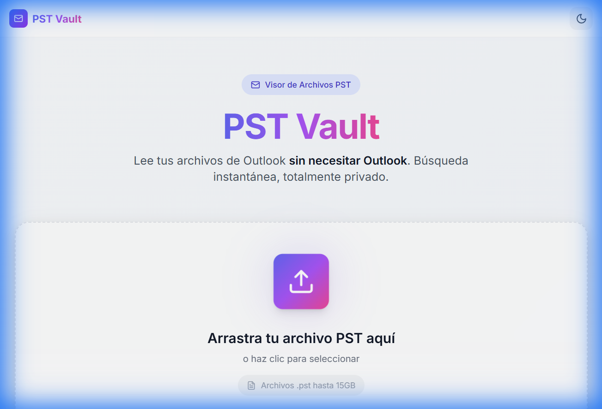
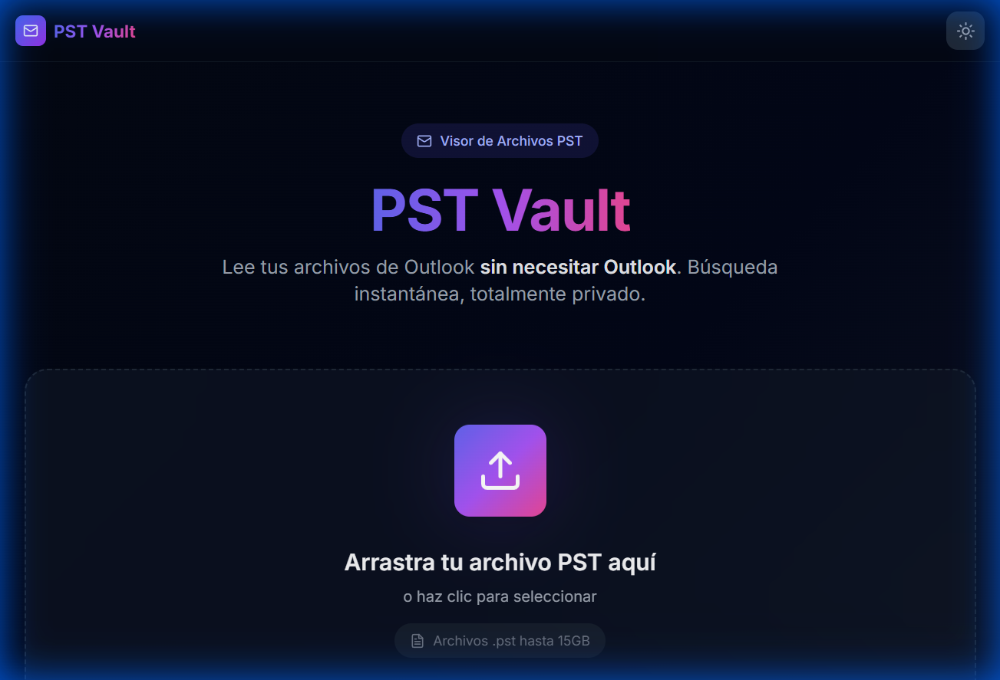

# 📧 PST Vault

> Lee tus archivos de Outlook (.pst) sin necesitar Microsoft Outlook. Búsqueda instantánea, 100% privado.


## ✨ Características

- 🔍 **Búsqueda avanzada** estilo Gmail (`from:`, `subject:`, `has:attachment`, etc.)
- 📁 **Navegación por carpetas** con estructura jerárquica
- 📎 **Extracción de adjuntos** con descarga directa
- 📤 **Exportación masiva** a ZIP con archivos EML
- 🌙 **Modo oscuro** con diseño premium
- 🔒 **100% privado** - tus datos nunca salen de tu dispositivo
- 📦 **Soporte para archivos grandes** hasta 15GB

## 🖼️ Preview

| Modo Claro | Modo Oscuro |
|------------|-------------|
|  |  |

---

## 🚀 Instalación Rápida

### Requisitos Previos

- **Python 3.11+** ([Descargar](https://www.python.org/downloads/))
- **Node.js 18+** ([Descargar](https://nodejs.org/))
- **Microsoft Outlook** instalado (para parsear archivos PST)
- **Git** ([Descargar](https://git-scm.com/downloads))

### 1. Clonar el Repositorio

```bash
git clone https://github.com/ezraidenn/PST-Vault.git
cd PST-Vault
```

### 2. Configurar Backend (Python/FastAPI)

```powershell
# Navegar al directorio backend
cd backend

# Crear entorno virtual
python -m venv venv

# Activar entorno virtual (Windows PowerShell)
.\venv\Scripts\Activate

# Instalar dependencias
pip install -r requirements.txt

# Copiar archivo de configuración
copy .env.example .env
```

### 3. Configurar Frontend (Next.js)

```powershell
# En otra terminal, navegar al directorio frontend
cd frontend

# Instalar dependencias
npm install

# Copiar archivo de configuración
copy .env.example .env.local
```

### 4. Iniciar los Servidores

**Terminal 1 - Backend:**
```powershell
cd backend
.\venv\Scripts\Activate
uvicorn app.main:app --reload --port 8000
```

**Terminal 2 - Frontend:**
```powershell
cd frontend
npm run dev
```

### 5. Abrir la Aplicación

🌐 Abre tu navegador en: **http://localhost:3000**

---

## ⚙️ Configuración

### Backend (.env)

```env
DATABASE_PATH=./data/app.db        # Ruta de base de datos SQLite
STORAGE_DIR=./storage              # Directorio para archivos PST y adjuntos
MAX_UPLOAD_MB=15000                # Límite de upload (15GB)
CORS_ORIGINS=http://localhost:3000,http://localhost:3001
MAX_ATTACHMENT_MB=100              # Límite por adjunto
```

### Frontend (.env.local)

```env
NEXT_PUBLIC_API_URL=http://localhost:8000
```

---

## 🔍 Sintaxis de Búsqueda

| Operador | Ejemplo | Descripción |
|----------|---------|-------------|
| `from:` | `from:juan` | Buscar por remitente |
| `to:` | `to:maria@email.com` | Buscar por destinatario |
| `subject:` | `subject:factura` | Buscar en asunto |
| `folder:` | `folder:Inbox` | Filtrar por carpeta |
| `has:attachment` | `has:attachment` | Solo con adjuntos |
| `filename:` | `filename:reporte.pdf` | Buscar por nombre de adjunto |
| `after:` | `after:2024-01-01` | Después de fecha |
| `before:` | `before:2024-12-31` | Antes de fecha |
| `"texto"` | `"texto exacto"` | Búsqueda de frase exacta |

**Ejemplo combinado:**
```
from:contabilidad subject:factura has:attachment after:2024-01-01
```

---

## 📁 Estructura del Proyecto

```
PST-Vault/
├── backend/
│   ├── app/
│   │   ├── core/           # Configuración y base de datos
│   │   ├── models/         # Schemas de Pydantic
│   │   ├── routes/         # Endpoints de API
│   │   └── services/       # Parser de PST
│   ├── requirements.txt
│   └── .env.example
├── frontend/
│   ├── app/                # Páginas de Next.js
│   ├── components/         # Componentes React
│   ├── lib/                # API client y utilidades
│   └── package.json
└── README.md
```

---

## 🔌 API Endpoints

| Método | Endpoint | Descripción |
|--------|----------|-------------|
| `POST` | `/pst/upload` | Subir archivo PST |
| `GET` | `/pst/{id}/status` | Estado de indexación |
| `GET` | `/folders` | Listar carpetas |
| `GET` | `/messages` | Listar mensajes |
| `GET` | `/messages/{id}` | Detalle de mensaje |
| `GET` | `/search` | Buscar mensajes |
| `GET` | `/messages/{id}/download` | Descargar como EML/JSON |
| `POST` | `/messages/export` | Exportar selección a ZIP |

📚 Documentación interactiva: **http://localhost:8000/docs**

---

## 🛠️ Desarrollo

### Scripts Disponibles

**Backend:**
```bash
# Desarrollo con auto-reload
uvicorn app.main:app --reload --port 8000

# Producción
uvicorn app.main:app --host 0.0.0.0 --port 8000
```

**Frontend:**
```bash
# Desarrollo
npm run dev

# Build de producción
npm run build

# Iniciar producción
npm run start

# Linter
npm run lint
```

---

## ❓ Solución de Problemas

### "No module named 'win32com'"
```powershell
pip install pywin32
```

### "Outlook no está instalado"
El parser requiere Microsoft Outlook instalado para leer archivos PST. Alternativa: usar WSL con `libpff-python`.

### Error de CORS
Asegúrate de que `CORS_ORIGINS` en `.env` incluya la URL del frontend.

### Archivo PST muy grande
El límite por defecto es 15GB. Puedes aumentarlo en `MAX_UPLOAD_MB` en `.env`.

---

## 📄 Licencia

Este proyecto está bajo la licencia MIT. Ver [LICENSE](LICENSE) para más detalles.

---

## 👨‍💻 Contribuir

1. Fork el repositorio
2. Crea una rama (`git checkout -b feature/nueva-funcionalidad`)
3. Commit tus cambios (`git commit -am 'Agregar nueva funcionalidad'`)
4. Push a la rama (`git push origin feature/nueva-funcionalidad`)
5. Abre un Pull Request

---

<p align="center">
  Hecho con ❤️ para leer correos sin Outlook
</p>
